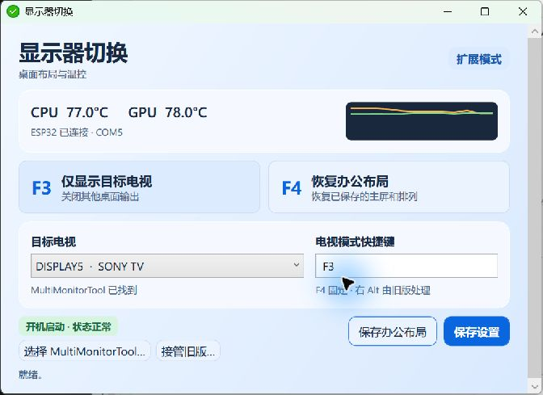
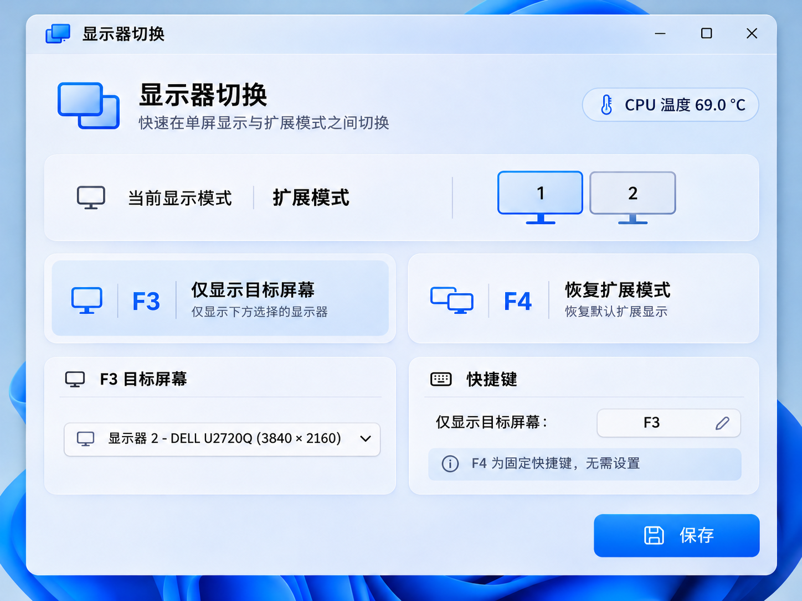

# 显示器切换 · Quick-Sleep · ESP32 温控

适用于 Windows 11 x64 的托盘工具。用 F3 将桌面输出切到索尼电视，用 F4 恢复保存的办公布局，单独按下并松开右 Alt 可暂停媒体并关屏。主窗口和托盘可以查看 CPU/GPU 温度及 ESP32 连接状态。

## 界面



上图为发布版窗口。CPU 和 GPU 温度来自本机传感器，橙色曲线对应 CPU，绿色曲线对应 GPU。

<details>
<summary>查看加上 CPU 温度的设计参考图</summary>



设计参考图中的 69.0 °C 为示例读数。

</details>

## 安装和首次设置

1. 将 **DisplaySwitcher.exe** 和 **FanWorker.exe** 放在同一目录。自行构建时，两者会生成在 **Release** 目录。
2. 准备已有的 **MultiMonitorTool.exe**。程序会在主程序所在目录和两级上级目录查找，也可以通过「选择 MultiMonitorTool…」手动指定。选择后点击「保存设置」。
3. 运行 **DisplaySwitcher.exe**。程序默认收进托盘。左键单击托盘图标打开窗口，再次双击 EXE 也会打开现有窗口。如果图标在折叠区，可在 Windows 任务栏设置里设为常显。
4. 在 Windows 显示设置中排好办公屏幕并设好主屏，然后点击「保存办公布局」。确认后会生成桌面快捷方式「恢复办公显示」。电视是否参与办公，以这次保存时的实际布局为准。
5. 在「目标电视」里选中实际连接的电视并保存设置。本机索尼 85XR70 显示为 **SONY TV**，设备码为 **SNY07CF**。下拉框中的 **DISPLAYn** 是 Windows 的输出名。鼠标悬停可查看设备码、设备路径和可用序列号。
6. 打开电视并选中实际连接的 HDMI 输入。按 F3 后，若电视画面正常，在 18 秒内点「画面正常，保留」。超时或点「立即恢复」会回到切换前的布局。确认后才会保存电视单屏快照。

## 快捷键和托盘

| 操作 | 行为 |
| --- | --- |
| **F3** | 仅保留已绑定电视的桌面输出。可在设置中更改此快捷键。 |
| **F4** | 恢复保存的办公活动屏、主屏、相对位置、方向、分辨率和刷新率。 |
| **Ctrl+Alt+F9** | 紧急恢复。若办公布局里的部分显示器不可用，会尝试启用仍可识别的办公屏。 |
| **右 Alt 单独按下并松开** | 暂停 Windows 媒体会话中的播放，然后发送一次关屏请求。 |
| **托盘图标左键** | 打开主窗口。悬停可看 CPU/GPU 当前温度。 |
| **托盘图标右键** | 切到电视、恢复办公、快速关屏或退出。 |

关闭窗口会把程序收回托盘。通过右键「退出」结束程序。热键被占用时窗口会显示提示，仍可使用鼠标按钮。

## 开机启动和移动目录

程序每次启动时读取当前进程的 **EXE 完整路径**，并登记为当前用户的开机启动命令。例如从 **D:\工具\DisplaySwitcher\DisplaySwitcher.exe** 运行，下次登录就从这个路径以托盘模式启动。

| 界面状态 | 含义 |
| --- | --- |
| 🟩 **开机启动 · 状态正常** | 启动项已读回，指向当前运行的 EXE。鼠标悬停可查看完整路径。 |
| 🟥 **开机启动 · 异常** | 写入失败、启动路径不一致，或 Windows 已禁用该启动项。鼠标悬停可查看原因。 |

移动软件前，先通过托盘菜单退出。将整个程序目录移到新位置，再运行新位置的 **DisplaySwitcher.exe**。它会更新同名注册表启动项，并清理当前用户指向旧位置的同程序注册表别名和「启动」文件夹快捷方式。其他程序的启动项按各自的设置保留。

若旧版 Quick-Sleep 或 CPU_fan 还在运行，可点「接管旧版」。程序会退出旧版，备份并停用它们各自的开机启动项。备份位置为 **%LOCALAPPDATA%\DisplaySwitcher\legacy-startup**。

## ESP32 温控

- 在 Windows 蓝牙设置中配对 **esp32散热器**。温控助手优先尝试 **COM5**，并复用原控制端的端口扫描和重连逻辑。
- PC 端以 **115200** 波特率发送 **CPUxx.x** 和 **GPUxx.x**。收到 ESP32 的 **ACK** 后，界面显示「已连接」和端口。只读到温度时，界面可以显示曲线，连接栏会提示「未确认连接」。
- 传感器和蓝牙串口在独立助手进程中工作。快速关屏和显示切换由主程序负责。休眠唤醒后，助手会重新读取传感器并尝试恢复蓝牙连接。
- 如果旧版 **CPU_fan.exe** 还在运行，主程序会等待它退出，避免两个进程争抢串口。
- 现有 ESP32 固件、蓝牙协议、OLED 显示及风扇曲线继续沿用。固件在蓝牙断开或两路温度都过期时按原逻辑停转。

## 数据和恢复

| 文件 | 用途 |
| --- | --- |
| **settings.json** | 目标电视物理身份、电视模式热键和 MultiMonitorTool 路径 |
| **office.json** / **office.cfg** | 办公布局的 Windows 路径快照和 MultiMonitorTool 快照 |
| **gaming.json** / **gaming.cfg** | 首次确认后的电视单屏配置 |
| **logs\\** | 启动注册、显示切换、回退和串口诊断日志 |

上述文件位于 **%LOCALAPPDATA%\DisplaySwitcher**。程序使用设备路径、EDID 指纹和可用序列号关联显示器。无法唯一识别时，F3 会停止并提示检查连接或重新绑定。每次切换会重新查询 Windows 实际输出，布局不匹配时尝试回退。电视处于待机时，若 HDMI 仍报告可用，Windows 只能确认输出路径，电视面板是否亮起需要现场确认。

| 现象 | 操作 |
| --- | --- |
| 电视黑屏或选错输入 | 先等待首次测试倒计时回退，也可用 **Ctrl+Alt+F9** 或桌面「恢复办公显示」。 |
| F4 没有恢复预期排列 | 确认所有办公屏在线。在 Windows 中重新排好扩展布局后再保存。镜像或混合模式不能保存为办公扩展布局。 |
| 开机启动为红色 | 悬停查看原因。路径变化时从正确位置重新运行；如 Windows 禁用了该项，请在「启动应用」中启用。 |
| 托盘有图标、温度显示 **--** | 查看界面提示和日志。可以运行 **FanWorker.exe --probe** 读取一次传感器，用于排查。 |
| 温度正常、ESP32 未连接 | 检查蓝牙配对、串口和旧版 CPU_fan 是否仍在运行。 |
| 右 Alt 后屏幕关闭但电脑仍工作 | 软件发送关屏请求。是否进入 S0 现代待机以及能否通过键盘唤醒，由 Windows、电源状态和设备决定。 |

## 从源码构建

准备 **.NET 10 SDK**、**64 位 Python 3.13** 和现有 CPU_fan 的硬件监控 DLL 目录。该目录应有原项目使用的 **OpenHardwareMonitorLib 1.0.9513**、**HidSharp**、**RAMSPDToolkit-NDD** 和配套程序集。构建脚本会在缺少所需 DLL 时报告文件名。

```powershell
python -m venv .venv
$python = (Resolve-Path '.\.venv\Scripts\python.exe').Path
& $python -m pip install -r '.\FanWorker\requirements.txt'
$dotnet = (Get-Command dotnet.exe).Source
.\build.ps1 -Dotnet $dotnet -Python $python -FanDependencies 'D:\原 CPU_fan 源码目录'
```

输出为 **Release\DisplaySwitcher.exe** 和 **Release\FanWorker.exe**。主程序自带 .NET 运行时，温控助手自带 Python 运行时及构建时提供的硬件依赖。MultiMonitorTool 和硬件监控 DLL 由使用者自行提供。分发 MultiMonitorTool 时请遵守其官方许可。 [MultiMonitorTool 官方说明](https://www.nirsoft.net/utils/multi_monitor_tool.html)

| 目录 | 内容 |
| --- | --- |
| **DisplaySwitcher/** | WPF 窗口、托盘、热键、快速关屏、Windows CCD 与 MultiMonitorTool 后端 |
| **FanWorker/** | CPU/GPU 读取、ESP32 串口、进程通讯及打包配置 |
| **docs/** | 实机截图与 CPU 温度版界面参考图 |

更多使用细节见 [中文使用说明](使用说明.md)。
